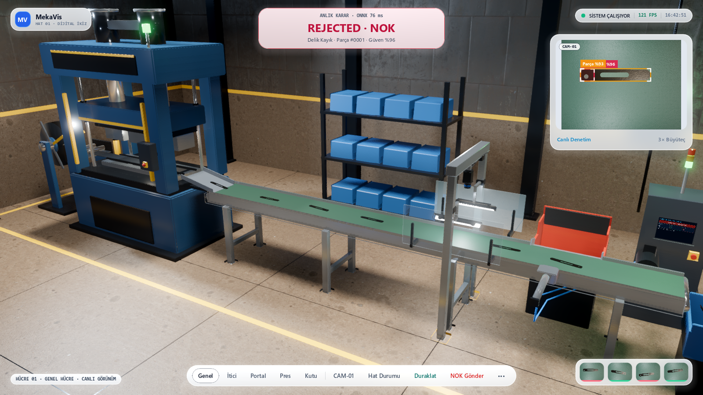
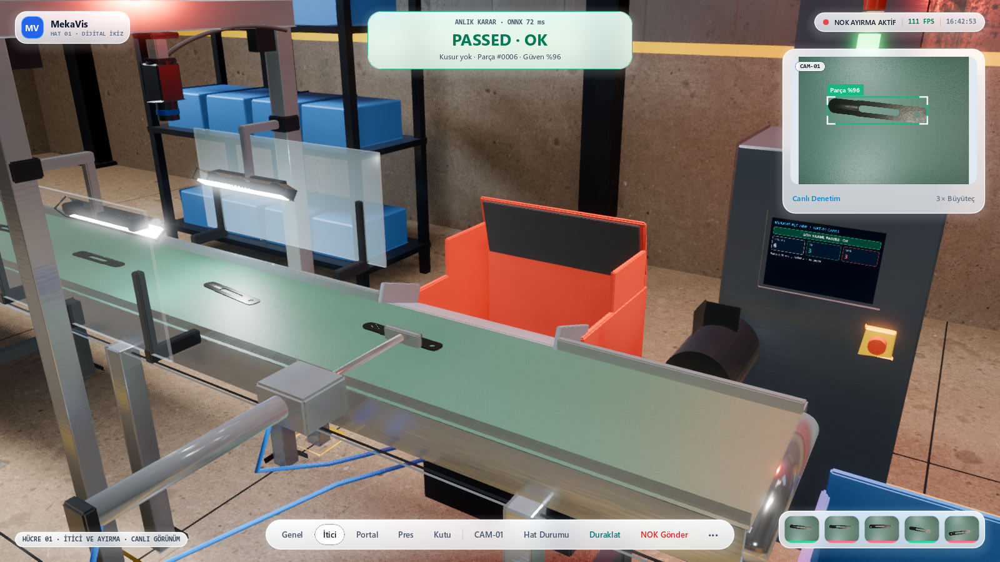
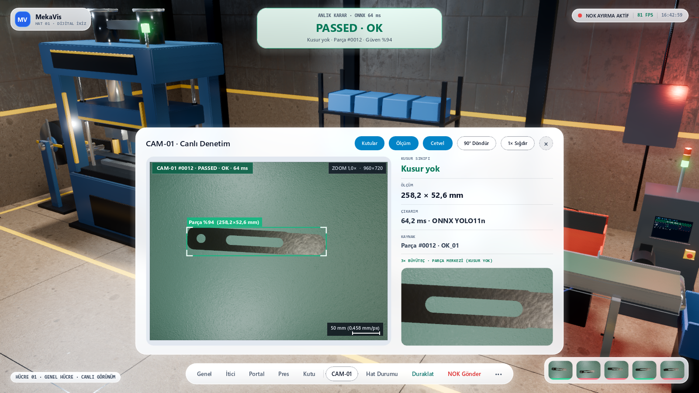
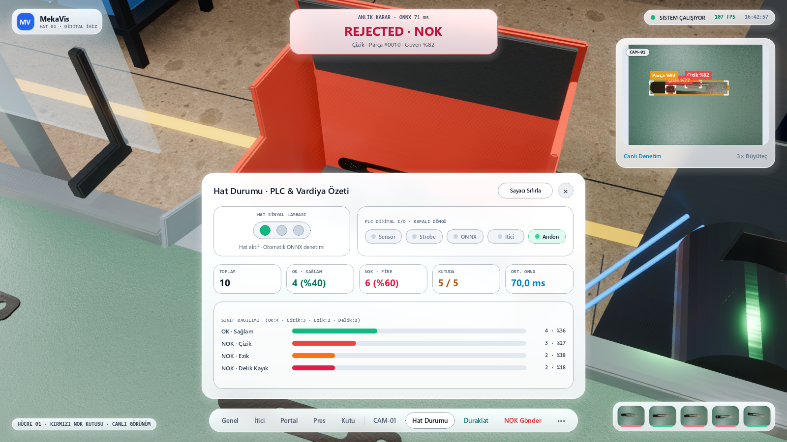
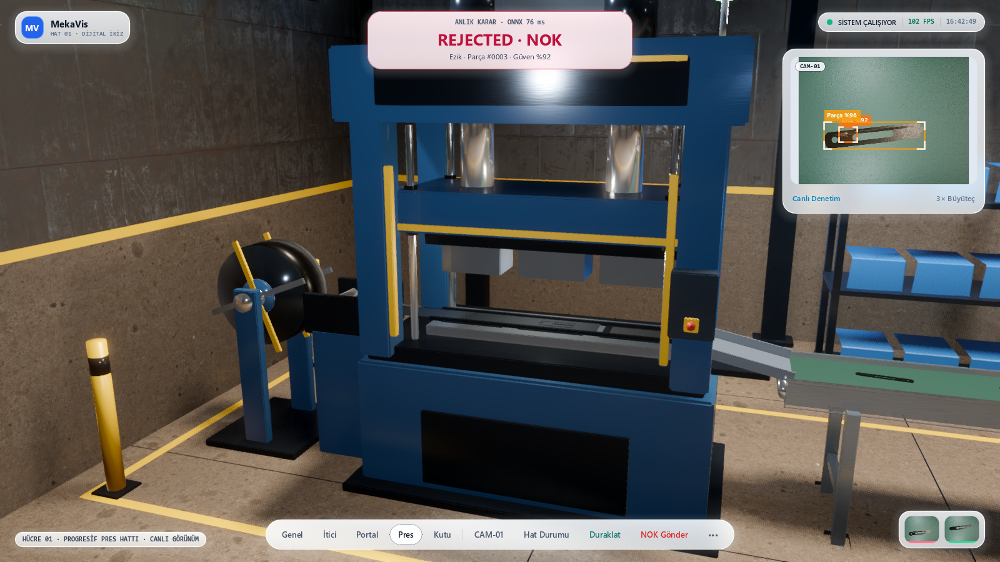
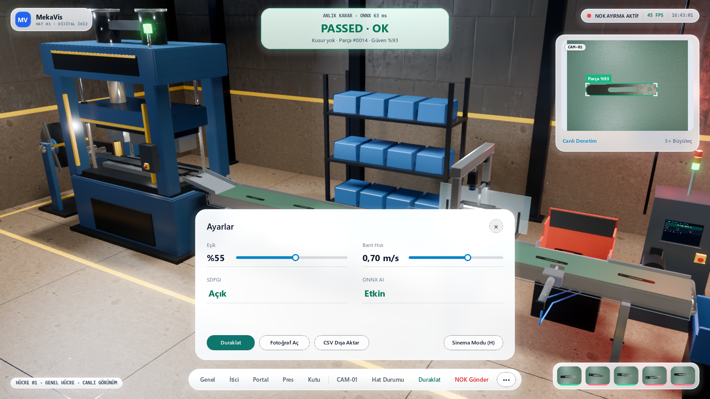
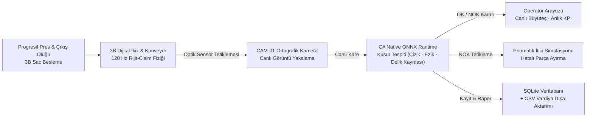

# MekaVis — 3B Dijital İkiz & Yapay Zekâ Destekli Görsel Kalite Kontrol

**MekaVis**, endüstriyel üretim hatlarındaki sac ve metal parçaların gerçek zamanlı **3B Vulkan dijital ikiz** ortamında simüle edildiği, üstten bakan sanal kamera (`CAM-01`) görüntülerinin **C# Native ONNX Runtime** üzerinde çalışan yapay zekâ modeliyle analiz edildiği ve hatalı (`NOK`) parçaların kapalı döngü pnömatik ayırma mekanizmasıyla ayrıldığı bir görsel kalite kontrol prototipidir.

> **Durum Notu:** Bu çalışma şu an 3B simülasyon ve fotoğraf testi aşamasında olan bir Ar-Ge prototipidir; doğrudan gerçek üretim hattı sertifikasyonu iddiası taşımaz. Bir sonraki aşama, gerçek fabrika numuneleri ve endüstriyel kamera/aydınlatma koşullarıyla doğrulama yapmaktır.

---

## Arayüz ve Simülasyon Görüntüleri

| Canlı 3B Hat & `PASSED · OK` | Kapalı Döngü Pnömatik Ayırma & `REJECTED · NOK` |
|---|---|
|  |  |

| `CAM-01 · Canlı Denetim` (Büyüteç & Kusur Kutuları) | `Hat Durumu` (Sinyal Lambası, PLC I/O & Vardiya) |
|---|---|
|  |  |

| 4 Kolonlu Progresif Pres & 3B Delikli Sac Besleme | `Ayarlar` (Güven Eşiği, Bant Hızı, AI Model) |
|---|---|
|  |  |

---

## Sistem Mimarisi (Kapalı Döngü)

---

## Öne Çıkan Teknik Özellikler

- **3B Fizik Tabanlı Hat Simülasyonu:** Godot 4.7 Vulkan Forward+ ve 120 Hz Jolt fizik motoru üzerinde progresif pres, eğimli çıkış oluğu, konveyör bandı, kamera portalı, pnömatik itici ve fire kutusu.
- **Doğrudan C# Üzerinde Yapay Zekâ Çıkarımı:** Harici Python servisi gerektirmeden uygulama içi **ONNX Runtime** ile her parça için milisaniye seviyesinde kusur tespiti (`Çizik`, `Ezik`, `Delik Kayması`).
- **Gerçek Kapalı Döngü Ayırma:** İtici yalnızca yapay zekânın canlı kamera görüntüsünden verdiği `NOK` kararına göre bant hızına uyarlı zamanlamayla tetiklenir.
- **Fotoğraf Testi & Raporlama:** Harici parça fotoğrafları yüklenerek model çıktısı incelenebilir; her parça kararı yerel **SQLite** veritabanına kaydedilir ve tek tıkla **CSV** vardiya raporu alınabilir.

---

## Kaynak Kod ve İletişim

Bu depo **MekaVis** projesinin tanıtım ve dokümantasyon vitrinidir. Uygulama kaynak kodları, 3B sahne varlıkları ve eğitilmiş model ağırlıkları kamuya açık değildir (*Tüm Hakları Saklıdır*).

Canlı demo, teknik geri bildirim veya gerçek üretim parçaları üzerinde ön değerlendirme için LinkedIn üzerinden iletişime geçebilirsiniz:

- **LinkedIn:** [Muhammet Emin Gerim](https://www.linkedin.com/in/megerim/)
